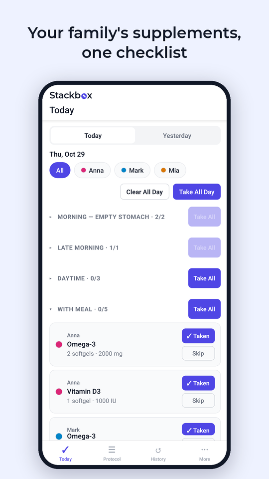
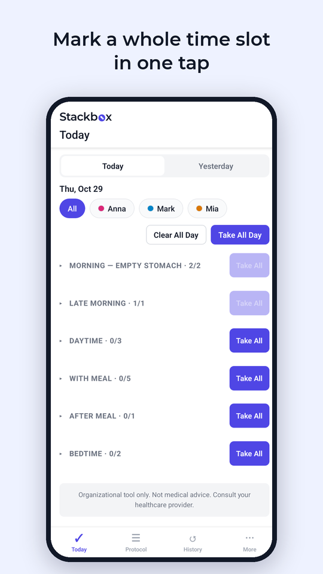
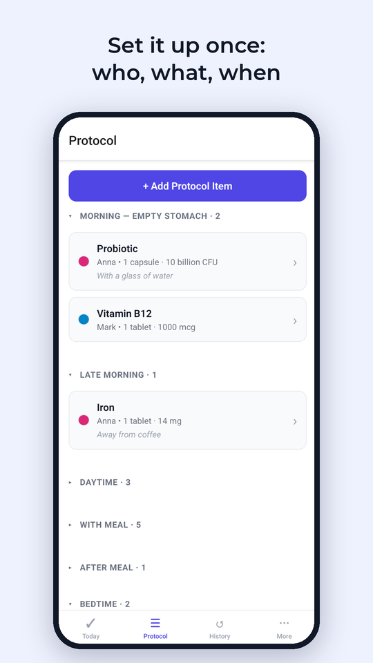
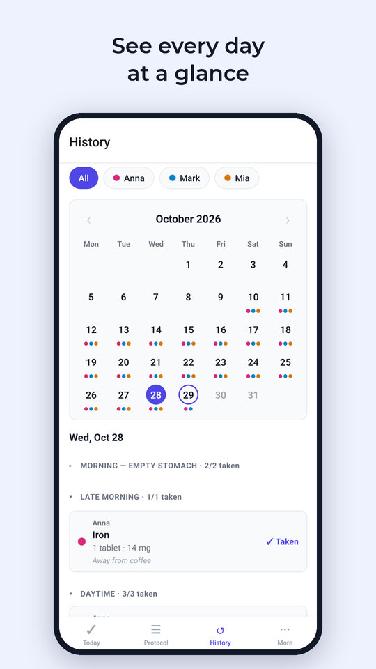
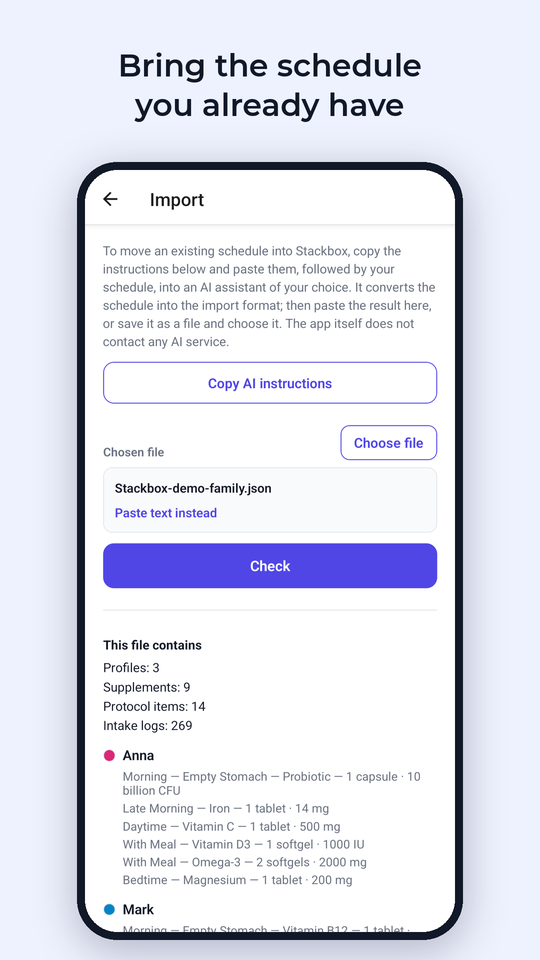
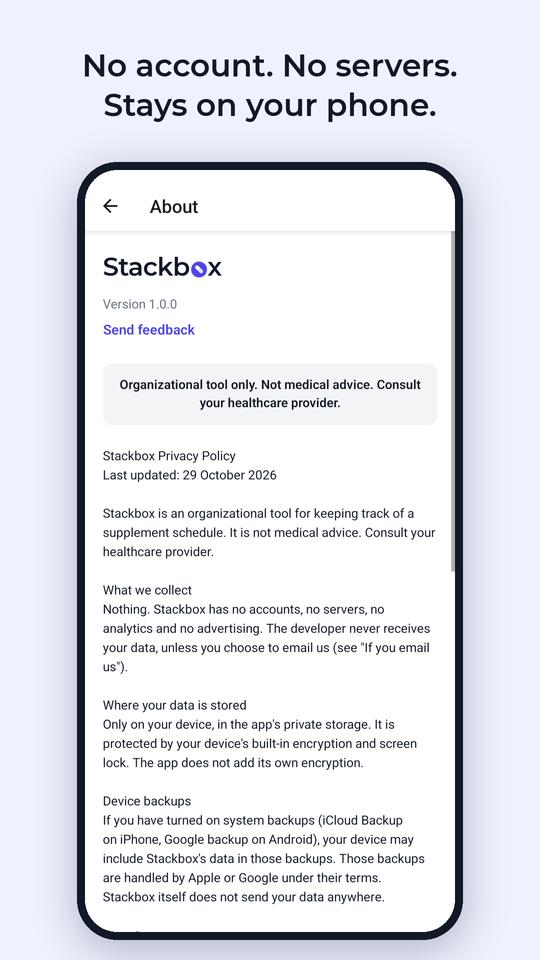

  <picture>
    <source media="(prefers-color-scheme: dark)" srcset="assets/wordmark-dark.png">
    
  </picture>

  <b>Your family's supplement schedule. Private, on-device.</b> 
  Plan and log supplements and vitamins for the whole family, by time of day. 
  No account, no servers, no tracking.

  <a href="https://bithard.co/stackbox/">Website</a> ·
  <a href="https://bithard.co/stackbox/support/">Support</a> ·
  <a href="https://bithard.co/stackbox/privacy/">Privacy policy</a>

<i>Coming soon to the App Store and Google Play.</i>

<table>
  <tr>
    <td></td>
    <td></td>
    <td></td>
  </tr>
  <tr>
    <td></td>
    <td></td>
    <td></td>
  </tr>
</table>

## What it does

Stackbox keeps your family's supplement schedule in one place and lets you mark what was taken: for yourself, your partner and your kids.

- **For the whole family.** A profile for each family member, each with its own color. The same supplement can have a different amount for each person.
- **Organized by time of day.** Seven time slots, from *Morning — Empty Stomach* to *Bedtime*, with your own notes such as "away from coffee".
- **Mark in one tap.** Taken or Skipped for each item, Take All for a time slot, or Take All Day. Clear undoes a wrong tap. Forgot yesterday? Switch to Yesterday and catch up.
- **History at a glance.** A month calendar with a colored dot for each family member who logged that day.
- **Bring the schedule you already have.** Enter it by hand, or copy Stackbox's instructions into the AI assistant you already use to convert your current schedule into a file to import. You see a preview before anything is replaced.
- **Your data, your file.** Export everything to a single file at any time, and import it on a new phone.

## Private by design

- No account or sign-up
- No servers: your data stays on your phone
- No analytics, ads or tracking
- No internet permission on Android
- Delete everything in one step

Read the [privacy policy](https://bithard.co/stackbox/privacy/).

## Download

Stackbox is coming soon to the App Store and Google Play. The Android APK will also be published under [Releases](../../releases).

## Example file

[`examples/demo-family.json`](examples/demo-family.json) is a demo family (three made-up people, nine supplements, three weeks of history) in the Stackbox import format. To try it: download the file to your phone, then in Stackbox open **More → Data → Import → Choose file**, tap **Check** and **Replace all data**.

> Import replaces everything that is in the app. Export your own data first if you want to keep it.

## Feedback and bug reports

- **Email:** [stackbox@bithard.co](mailto:stackbox@bithard.co), or **More → Send feedback** in the app (it fills in the app version and device details for you).
- **GitHub Issues:** [open an issue](../../issues/new/choose). Issues are public: please don't post your real names, supplements or health information.

## Important

Stackbox is an organizational tool for keeping track of a supplement schedule you already follow. It does not give medical advice, diagnose, recommend doses or check interactions. Amounts shown are only the numbers you entered. Consult your healthcare provider about your supplements.

---

© 2026 Bithard International OÜ, Tallinn, Estonia. All rights reserved.
This repository contains the app's public information, releases and issue tracker. The source code is not public.
